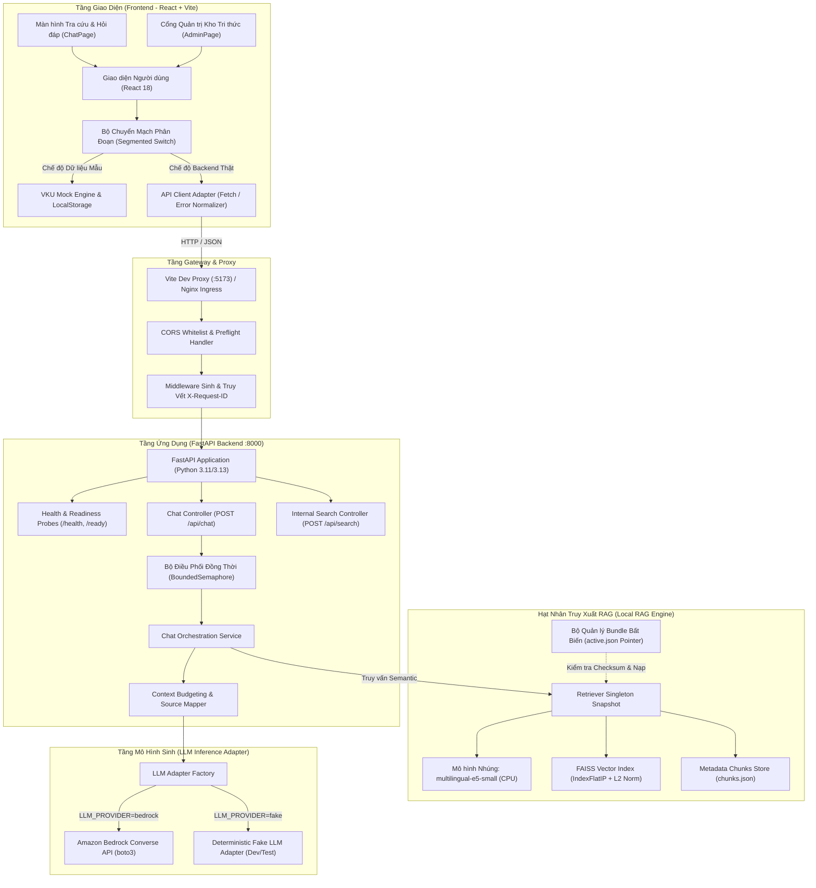
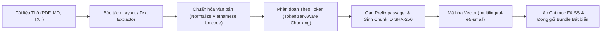
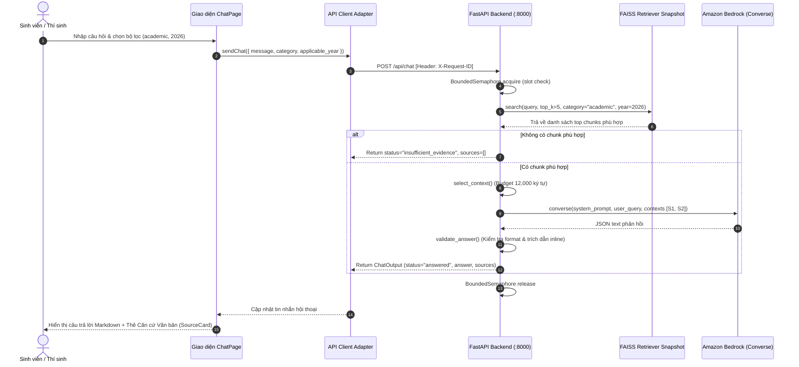
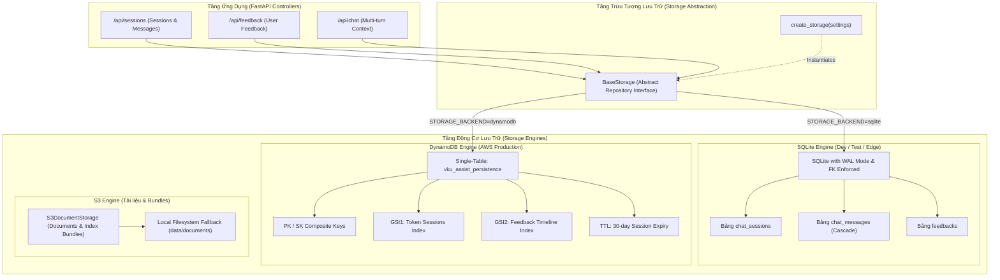
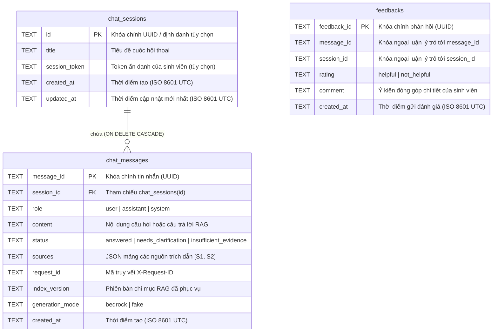
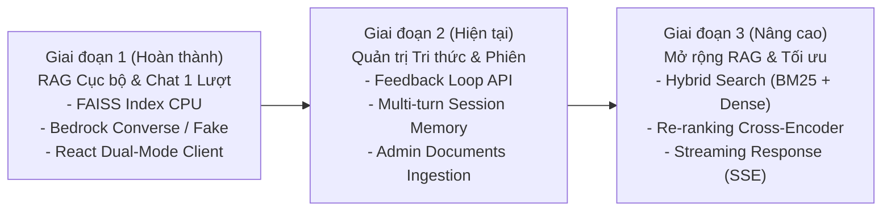

# TÀI LIỆU KIẾN TRÚC HỆ THỐNG & ĐỒNG BỘ HỢP ĐỒNG API CONTRACT
# VKU ASSIST — TRỢ LÝ HỌC VỤ & TUYỂN SINH THÔNG MINH

**Đơn vị phát triển:** Dự án Trợ lý ảo Học vụ & Tuyển sinh VKU  
**Phiên bản tài liệu:** v2.0-STABLE  
**Trạng thái kiểm chứng:** Đã đồng bộ API Contract giữa Frontend (React/Vite) và Backend (FastAPI)  
**Ngày cập nhật:** Tháng 11/2026  

---

## 1. TỔNG QUAN HỆ THỐNG (EXECUTIVE OVERVIEW)

**VKU Assist** là nền tảng trợ lý ảo hỗ trợ sinh viên và thí sinh tra cứu chính xác, tức thì các thông tin liên quan đến quy chế đào tạo theo hệ thống tín chỉ, chính sách học phí - học bổng và các đề án tuyển sinh Đại học chính quy của **Trường Đại học Công nghệ Thông tin và Truyền thông Việt - Hàn (VKU), Đại học Đà Nẵng**.

### 1.1. Nguyên tắc Thiết kế Cốt lõi (Design Principles)
1. **Grounding tuyệt đối (Fact-Grounded Only):** Mọi câu trả lời của hệ thống bắt buộc phải dựa trên căn cứ văn bản chính thức được lưu trữ trong kho chỉ mục. Tuyệt đối không suy diễn, không tạo ảo giác (anti-hallucination). Nếu không đủ bằng chứng, hệ thống trung thực từ chối (`insufficient_evidence`).
2. **Trích dẫn nguồn minh bạch (Explicit Source Citations):** Tất cả các câu khẳng định trong câu trả lời đều được gắn thẻ tham chiếu nguồn cụ thể `[S1]`, `[S2]`, kèm metadata chi tiết (tên văn bản, điều khoản/trang, năm áp dụng, phiên bản và liên kết gốc).
3. **Phân tách ranh giới rõ ràng (Decoupled Boundaries):** Frontend (React + Vite) và Backend (FastAPI) giao tiếp qua hợp đồng API chuẩn mực (API Contract) với Error Envelope đồng nhất.
4. **Vận hành linh hoạt hai chế độ (Dual-Mode Execution):** Hỗ trợ chuyển đổi mượt mà giữa chế độ **Dữ liệu mẫu nội bộ (VKU Mock Knowledge Base)** độc lập và **Backend RAG thật (FastAPI Cổng 8000)** mà không làm gián đoạn trải nghiệm người dùng.

---

## 2. KIẾN TRÚC TỔNG THỂ HỆ THỐNG (SYSTEM ARCHITECTURE)

Hệ thống được tổ chức theo mô hình kiến trúc phân lớp hiện đại (Layered Microservice Architecture), bảo đảm khả năng mở rộng, bảo mật và hiệu năng cao trên hạ tầng CPU / Điện toán đám mây.



---

## 3. KHẢO SÁT CHI TIẾT HẠT NHÂN RAG (RAG ENGINE DEEP-DIVE)

### 3.1. Quy trình Nạp & Tiền xử lý Dữ liệu (Ingestion Pipeline)
Kho dữ liệu của VKU Assist tiếp nhận các văn bản học vụ và tuyển sinh chính thức dưới 3 định dạng: **PDF**, **Markdown (.md)** và **Văn bản thuần (.txt)**.



* **Xử lý PDF:** Sử dụng `pypdf` với chế độ `layout`. Đánh số trang bắt đầu từ trang file (1-based), từ chối PDF mã hóa hoặc các trang không trích xuất được text.
* **Xử lý Markdown:** Nhận diện và bóc tách theo các tiêu đề heading thực tế (`#`, `##`, `###`), bảo toàn nguyên vẹn ngữ cảnh tiêu đề trong từng phân đoạn.
* **Chuẩn hóa Unicode tiếng Việt:** Không loại bỏ dấu, chuẩn hóa khoảng trắng ngang, duy trì tính toàn vẹn của các hàng trong bảng biểu quy chế.

### 3.2. Chiến lược Phân đoạn (Chunking Strategy)
* **Kích thước cửa sổ:** `CHUNK_SIZE = 300` token, `CHUNK_OVERLAP = 50` token.
* **Tokenizer-Aware Slicing:** Sử dụng bảng ánh xạ offset ký tự (`offset_mapping`) của Tokenizer gốc `intfloat/multilingual-e5-small` để cắt trực tiếp trên chuỗi Unicode gốc. Giải pháp này khắc phục triệt để lỗi vỡ font tiếng Việt và bảo tồn định dạng bảng học phí.
* **Prefixing theo khuyến nghị của E5:**
  - Văn bản tài liệu: Tự động gán tiền tố `passage: `
  - Câu truy vấn người dùng: Tự động gán tiền tố `query: `
* **Định danh phân đoạn (Deterministic Chunk ID):** Mã băm SHA-256 được tính toán từ bộ nhận diện:
  $$\text{chunk\_id} = \text{SHA256}(\text{document\_id} + \text{version} + \text{content\_hash} + \text{section\_index} + \text{start} + \text{end})$$

### 3.3. Bộ lưu trữ Vector & Quản lý Vòng đời Chỉ mục (Vector Store & Lifecycle)
* **Chỉ mục FAISS:** Sử dụng `faiss.IndexFlatIP` (Inner Product) kết hợp chuẩn hóa vector L2 ($||v||_2 = 1$), mang lại kết quả tương đương Cosine Similarity với độ chính xác cao và tốc độ truy vấn vượt trội trên CPU.
* **Cấu trúc Bundle Bất biến (Immutable Bundle):**
  Mỗi phiên bản lập chỉ mục được lưu trữ độc lập tại thư mục `indexes/<index_version>/`:
  - `index.faiss`: File nhị phân lưu trữ chỉ mục vector FAISS.
  - `manifest.json`: Chứa cấu hình embedding, thông số chunking, danh sách văn bản và mã băm SHA-256.
  - `chunks.json`: Mảng JSON lưu trữ toàn bộ nội dung và metadata chi tiết của từng đoạn chunk.
* **Cơ chế Hoán đổi Con trỏ Nguyên tử (Atomic Pointer Swap):** File `indexes/active.json` chứa `index_version` và `manifest_sha256`. Khi khởi động hoặc nâng cấp, backend đọc con trỏ này và kiểm chứng toàn vẹn mã băm. Nếu checksum sai lệch, hệ thống từ chối khởi động nhằm bảo đảm an toàn dữ liệu.
* **Tiền lọc Metadata (Pre-filtering):** Tận dụng `faiss.IDSelectorBatch` để lọc chính xác theo `category` (`academic` | `admissions`) và `applicable_year` trong lúc tìm kiếm FAISS, không cần rebuild index và không làm mất phân bổ $K$ kết quả cao nhất.

### 3.4. Mô hình Sinh Phản hồi & Dẫn nguồn LLM (Generation & Grounding Engine)
* **Ngân sách Ngữ cảnh (Context Budget):** Giới hạn tối đa `CHAT_MAX_CONTEXT_CHARS = 12000` ký tự Unicode. Hệ thống chỉ đóng gói các chunk nguyên vẹn (intact chunks); không bao giờ cắt vụn chunk để tránh việc LLM trích dẫn sai sự thật.
* **Đánh số nguồn cục bộ:** Các chunk trong ngữ cảnh được đánh số theo thứ tự ưu tiên `[S1]`, `[S2]`, ...
* **System Prompt & Khung Ràng buộc Pydantic (`ModelAnswer`):**
  - Trạng thái phản hồi chuẩn hóa:
    1. `answered`: Đã tìm thấy đầy đủ căn cứ và trả lời chi tiết. Bắt buộc phải có trích dẫn `[S1]`.
    2. `needs_clarification`: Câu hỏi mơ hồ hoặc thiếu dữ kiện quan trọng (ví dụ thiếu năm học hoặc ngành cụ thể).
    3. `insufficient_evidence`: Không có dữ liệu trong kho văn bản chính thức của Nhà trường.
* **Anti-Hallucination Guardrails (Hàng rào Chống Ảo giác):**
  - Kiểm tra đối chiếu trích dẫn: Mọi ký hiệu `[S...]` trong văn bản câu trả lời phải nằm trong danh sách ngữ cảnh thực sự gửi lên model.
  - Kiểm tra regex chặn liên kết ngoài: Cấm LLM tự sinh liên kết `http/https` hoặc đường dẫn hệ thống nội bộ.
  - Short-circuit Insufficient Evidence: Nếu bước tìm kiếm không thu được đoạn văn bản nào phù hợp sau khi lọc, hệ thống trả về `insufficient_evidence` ngay lập tức mà không gọi LLM.

---

## 4. MA TRẬN ĐỒNG BỘ HỢP ĐỒNG API (API CONTRACT SYNCHRONIZATION)

Hợp đồng API giữa Frontend (React/Vite) và Backend (FastAPI) được đồng bộ hóa hoàn toàn trên cơ sở Pydantic V2 Schema và Error Envelope thống nhất.

| STT | Tên API & Mục đích | Phương thức & Endpoint | Request Header | Request Body (Payload) | Response Model (HTTP 200) | Mã Lỗi Chuẩn Hóa |
| :---: | :--- | :--- | :--- | :--- | :--- | :---: |
| **1** | **Health Probe**<br>(Kiểm tra tiến trình FastAPI) | `GET /health` | `Accept: application/json` | *Không có* | `{"status": "ok", "service": "VKU Assist"}` | `500` |
| **2** | **Ready Probe**<br>(Kiểm tra FAISS Index & LLM Adapter) | `GET /ready` | `Accept: application/json` | *Không có* | `{"status": "ready", "index_version": "...", "scope": "retrieval_and_chat_configuration"}` | `503` (`retrieval_index_missing`, `chat_not_configured`,...) |
| **3** | **Chat Một Lượt Có Nguồn**<br>(Tra cứu học vụ & tuyển sinh) | `POST /api/chat` | `Content-Type: application/json`<br>`X-Request-ID: <UUID-v4>` | `{"message": str, "category": "academic"\|"admissions"\|null, "applicable_year": int\|null}` | `ChatOutput` (gồm `message_id`, `request_id`, `status`, `answer`, `sources`, `index_version`, `generation_mode`) | `422` (invalid_request)<br>`429` (chat_concurrency_exceeded)<br>`502` (invalid_llm_response)<br>`503` (chat_disabled) |
| **4** | **Truy xuất Cục bộ (Dev)**<br>(Kiểm tra chất lượng đoạn chunk) | `POST /api/search` | `Content-Type: application/json`<br>`X-Request-ID: <UUID-v4>` | `{"query": str, "top_k": int, "category": str, "applicable_year": int}` | `{"query": str, "index_version": str, "request_id": str, "results": [...]}` | `404` (prod)<br>`422` (query_too_long)<br>`503` (retrieval_not_ready) |
| **5** | **Thu thập Phản hồi**<br>(User Feedback - Phase 2) | `POST /api/feedback` | `Content-Type: application/json` | `{"message_id": str, "rating": "helpful"\|"not_helpful", "comment": str}` | `{"status": "recorded", "message_id": str}` | `422`, `500` |
| **6** | **Quản lý Phiên & Lịch sử**<br>(Session Memory - Phase 2) | `POST /api/sessions`<br>`GET /api/sessions/{id}` | `Authorization: Bearer ...` | `{"title": str}` | `{"session_id": str, "messages": [...]}` | `401`, `404` |
| **7** | **Đăng nhập Quản trị**<br>(Admin Token - Phase 2) | `POST /api/admin/login` | `Content-Type: application/json` | `{"username": str, "password": str}` | `{"access_token": str, "token_type": "bearer", "expires_at": int}` | `401` |
| **8** | **Quản trị Văn bản RAG**<br>(Documents Ingestion - Phase 2) | `GET /api/admin/documents`<br>`POST /api/admin/documents` | `Authorization: Bearer ...` | Multipart/Form: `file`, `title`, `category`, `applicable_year` | `{"document_id": str, "job_id": str, "status": "accepted"}` | `400`, `401`, `413` |

### 4.1. Chi tiết Schema Request & Response Cho `POST /api/chat`

#### Request Payload Model (Pydantic: `ChatInput`)
```json
{
  "message": "Điều kiện để được xét nhận học bổng khuyến khích học tập kỳ 1 năm 2026?",
  "category": "academic",
  "applicable_year": 2026
}
```
* **Ràng buộc:** `extra="forbid"`, `strict=True`. Không gửi bất kỳ trường thừa nào ngoài 3 trường trên. `message` có độ dài 1–2000 ký tự và không được là chuỗi khoảng trắng rỗng.

#### Response Payload Model (Pydantic: `ChatOutput`)
```json
{
  "message_id": "8fa1e42c-2b63-4a88-842f-2d6f6e80b2d1",
  "request_id": "c71a39d8-912f-4882-95f2-39c4d9b1a03f",
  "status": "answered",
  "answer": "Căn cứ theo Quy chế đào tạo tín chỉ VKU, để được xét học bổng khuyến khích học tập sinh viên cần đạt điểm trung bình chung học tập từ 3.2 trở lên và điểm rèn luyện đạt loại Tốt [S1].",
  "sources": [
    {
      "source_id": "S1",
      "chunk_id": "e3b0c44298fc1c149afbf4c8996fb92427ae41e4649b934ca495991b7852b855",
      "document_id": "doc-vku-academic-regs-2025",
      "title": "Quy chế đào tạo trình độ Đại học theo hệ thống tín chỉ VKU",
      "url": "https://vku.udn.vn/dao-tao/quy-che-tin-chi",
      "page_or_section": "Điều 18: Chính sách khen thưởng và học bổng",
      "applicable_year": 2025,
      "document_version": "v1.4"
    }
  ],
  "index_version": "f1837bc5d1124efaa266297312a0f8ec",
  "generation_mode": "bedrock"
}
```

### 4.2. Khung Bọc Lỗi Thống Nhất (Uniform Error Envelope)
Tất cả các phản hồi lỗi HTTP (422, 429, 500, 502, 503, 504) trên toàn hệ thống đều tuân thủ chặt chẽ định dạng Error Envelope sau:

```json
{
  "error": {
    "code": "chat_concurrency_exceeded",
    "message": "Đang có quá nhiều yêu cầu hỏi đáp. Vui lòng thử lại sau.",
    "request_id": "c71a39d8-912f-4882-95f2-39c4d9b1a03f"
  }
}
```

#### Bảng Tra Cứu Mã Lỗi Hệ Thống:
| HTTP Status | Mã Lỗi (`code`) | Nguyên nhân & Hành vi Xử lý |
| :---: | :--- | :--- |
| **422** | `invalid_request` | Dữ liệu đầu vào sai cú pháp schema hoặc chứa trường cấm. |
| **422** | `message_too_long` | Độ dài câu hỏi vượt quá cấu hình `CHAT_MAX_MESSAGE_CHARS`. |
| **422** | `message_exceeds_embedding_limit` | Số lượng token câu hỏi vượt ngưỡng tối đa của mô hình E5 (512 tokens). |
| **429** | `chat_concurrency_exceeded` | Tất cả các slot xử lý đồng thời (`CHAT_MAX_CONCURRENCY`) đang bận. |
| **502** | `invalid_llm_response` | Phản hồi từ LLM không đúng định dạng JSON, sai trích dẫn nguồn hoặc bị lỗi stop reason. |
| **503** | `chat_disabled` | Biến môi trường `CHAT_ENABLED=false`. |
| **503** | `retrieval_not_ready` / `retrieval_index_missing` | Bộ chỉ mục FAISS hoặc file `active.json` chưa được khởi tạo. |
| **503** | `bedrock_quota_exceeded` | Vượt hạn mức Throttling / Quota của Amazon Bedrock. |
| **504** | `bedrock_timeout` | Quá thời gian chờ phản hồi từ AWS Bedrock (`LLM_READ_TIMEOUT`). |

---

## 5. KIẾN TRÚC GIAO DIỆN FRONTEND (REACT / VITE ARCHITECTURE)

### 5.1. Bộ Chuyển Mạch Phân Đoạn Hai Chiều (Segmented Dual-Mode Switch)
Frontend được tích hợp sẵn 2 nguồn dữ liệu có thể chuyển đổi tức thì thông qua nút gạt tại thanh điều hướng:
1. **Dữ liệu mẫu nội bộ (VKU Mock Knowledge Base):** Cho phép trình diễn, thử nghiệm đầy đủ tính năng hỏi đáp quy chế học vụ, đề án tuyển sinh, chuẩn đầu ra TOEIC và quản trị kho tài liệu hoàn toàn cục bộ trên trình duyệt mà không cần cài đặt Python hay kết nối backend.
2. **Backend Thật (Cổng 8000):** Kết nối trực tiếp với dịch vụ FastAPI, truy xuất qua chỉ mục vector FAISS và sinh câu trả lời bằng Amazon Bedrock / Fake Adapter. Có tính năng tự động chuyển đổi dự phòng (Graceful Degradation) khi Backend mất kết nối.

### 5.2. Luồng Xử lý Hỏi đáp & Hiển thị Trích dẫn (Chat Interaction Flow)


### 5.3. Trải nghiệm Người dùng Chuẩn mực (UI/UX Design System)
* **Khung nhìn cố định (Rigid Shell 100vh):** Thiết kế `height: 100vh; overflow: hidden`, chia phân vùng độc lập giữa thanh bên (Sidebar), danh sách lịch sử phiên và khung hội thoại. Thanh nhập liệu luôn ghim cố định ở đáy, không bị đẩy trôi khi nội dung cuộn.
* **Hệ thống Design Token Nhận diện VKU:**
  - Màu chủ đạo: Xanh Navy Đại học (`#003366`), Cam VKU Năng động (`#E65100`), Đỏ nhấn (`#C62828`).
  - Hỗ trợ toàn diện 2 chủ đề Sáng (Light Theme) và Tối (Dark Theme).
* **Quản trị Lịch sử Phiên An toàn:** Quản lý lịch sử hội thoại độc lập, hỗ trợ tạo hội thoại mới, đổi phiên và xóa toàn bộ lịch sử có hộp thoại xác nhận chống thao tác nhầm.

---

## 6. KIẾN TRÚC TẦNG LƯU TRỮ BỀN VỮNG (PERSISTENCE LAYER ARCHITECTURE)

Hệ thống VKU Assist áp dụng mô hình kiến trúc lưu trữ cắm rút (Pluggable Persistence Architecture) dựa trên mẫu thiết kế Repository (`BaseStorage`), cho phép chuyển đổi linh hoạt giữa lưu trữ cục bộ nhúng (**SQLite**) cho môi trường phát triển/kiểm thử đơn máy và lưu trữ đám mây không máy chủ (**AWS DynamoDB**) cho môi trường sản xuất đa vùng có tính sẵn sàng cao.



### 6.1. Hợp đồng Giao tiếp Tầng Lưu trữ (`BaseStorage`)
Tất cả các phương thức thao tác dữ liệu được quy chuẩn hóa trong lớp trừu tượng `BaseStorage` (`backend/app/storage/base.py`):
- **Quản lý Phiên (`chat_sessions`):** `create_session()`, `get_session()`, `list_sessions()`, `update_session()`, `delete_session()`, `clear_sessions()`.
- **Quản lý Tin nhắn (`chat_messages`):** `add_message()` (tự động khởi tạo phiên nếu chưa tồn tại), `get_messages()`, `delete_message()`.
- **Quản lý Phản hồi (`feedbacks`):** `create_feedback()`, `list_feedbacks()`, `get_feedback()`, `delete_feedback()`.
- **Vòng đời tài nguyên:** `close()`.

---

### 6.2. Thiết kế Cơ sở Dữ liệu Quan hệ SQLite (Development & Single-Node)

#### 1. Sơ đồ Thực thể Quan hệ (ERD - SQLite):


#### 2. Tối ưu hóa Hiệu năng & Ràng buộc SQLite:
* **Khóa ngoại tự động nối tầng (`PRAGMA foreign_keys = ON`):** Khi xóa một phiên (`chat_sessions`), tất cả các tin nhắn (`chat_messages`) thuộc phiên đó sẽ tự động bị xóa triệt để, ngăn chặn rác dữ liệu mồ côi.
* **Ghi nhật ký song song (`PRAGMA journal_mode = WAL`):** Kích hoạt chế độ Write-Ahead Logging cho phép nhiều luồng đọc đồng thời mà không bị khóa bởi luồng ghi.
* **Chỉ mục tăng tốc:**
  - `idx_messages_session`: Tối ưu hóa truy vấn lịch sử tin nhắn theo `session_id` (`ORDER BY created_at ASC`).
  - `idx_feedbacks_message`: Tối ưu hóa tra cứu phản hồi theo tin nhắn AI.

---

### 6.3. Thiết kế Bảng Đơn DynamoDB (AWS Serverless Single-Table Design)

Khi hệ thống triển khai trên cụm máy chủ AWS (EC2/ECS/Lambda), việc sử dụng DynamoDB Single-Table Design giúp tối ưu hóa chi phí đọc/ghi (RCU/WCU) và đạt độ trễ sub-10ms.

#### 1. Cấu trúc Khóa & Bản đồ Dữ liệu (Key Mapping Table):

| Thực thể (Entity) | Partition Key (`PK`) | Sort Key (`SK`) | `GSI1PK` | `GSI1SK` | `GSI2PK` | `GSI2SK` | Thuộc tính bổ sung |
| :--- | :--- | :--- | :--- | :--- | :--- | :--- | :--- |
| **Session Metadata** | `SESSION#{session_id}` | `METADATA` | `TOKEN#{session_token}` hoặc `ALL_SESSIONS` | `updated_at` | — | — | `id`, `title`, `session_token`, `created_at`, `updated_at`, `ttl` |
| **Chat Message** | `SESSION#{session_id}` | `MSG#{created_at}#{message_id}` | — | — | — | — | `message_id`, `role`, `content`, `status`, `sources`, `request_id`, `generation_mode` |
| **User Feedback** | `FEEDBACK#{feedback_id}` | `METADATA` | — | — | `ALL_FEEDBACK` | `created_at` | `feedback_id`, `message_id`, `session_id`, `rating`, `comment` |

#### 2. Các mẫu Truy vấn Chính (Access Patterns):
1. **Lấy chi tiết phiên kèm toàn bộ tin nhắn trong 1 truy vấn:**
   - `Query(PK = "SESSION#{session_id}")`: Trả về đồng thời bản ghi `METADATA` của phiên và toàn bộ các tin nhắn `MSG#...`, tiết kiệm 50% số cuộc gọi mạng so với kiến trúc đa bảng.
2. **Liệt kê danh sách phiên của sinh viên theo thời gian cập nhật mới nhất:**
   - `Query(GSI1, GSI1PK = "TOKEN#{token}", ScanIndexForward = False)`: Sắp xếp giảm dần theo thời gian cập nhật gần nhất.
3. **Thêm tin nhắn bảo đảm thứ tự thời gian:**
   - Tiền tố `SK = MSG#{created_at}#{message_id}` tự động sắp xếp tin nhắn theo đúng thứ tự thời gian tự nhiên nhờ tính chất sắp xếp từ điển của định dạng ISO 8601.
4. **Vòng đời & Dọn dẹp dữ liệu tự động (DynamoDB TTL):**
   - Thuộc tính `ttl` (epoch timestamp) được gán cho các phiên làm việc của người dùng ẩn danh (ví dụ: tự động giải phóng sau 30 ngày), giúp hệ thống tự duy trì mà không cần cron job xóa dữ liệu định kỳ.

---

### 6.4. Kho Lưu trữ Tài liệu & Snapshot Văn bản (`S3DocumentStorage`)
Hỗ trợ lưu trữ tài liệu quy chế gốc (PDF, MD, TXT) và các gói chỉ mục vector FAISS bất biến (`indexes/<index_version>/`):
- **Môi trường Đám mây (AWS S3):** Sử dụng `boto3.client('s3')` kết hợp mã hóa phía máy chủ (SSE-S3) và phân loại metadata.
- **Môi trường Cục bộ (Fallback):** Tự động điều hướng ghi nhận vào thư mục cục bộ `data/documents/` khi không cấu hình S3 credentials.

---

## 7. BẢO MẬT, ĐỘ TIN CẬY & QUẢN TRỊ TÀI NGUYÊN

1. **Điều phối Tài nguyên Đồng thời (Concurrency Throttling):**
   Backend sử dụng `BoundedSemaphore` giới hạn số lượng tác vụ LLM chạy song song trong một tiến trình (mặc định `CHAT_MAX_CONCURRENCY = 2`). Khi vượt quá ngưỡng, hệ thống từ chối an toàn với mã lỗi HTTP 429 `chat_concurrency_exceeded`, ngăn chặn tình trạng cạn kiệt RAM và quá tải CPU.
2. **Bảo mật Thông tin & Chống Rò rỉ Dữ liệu:**
   - Hệ thống không ghi log nội dung tin nhắn người dùng, body request hoặc thông tin xác thực vào access log.
   - Khi gặp lỗi thẩm định (Validation Error 422), hệ thống không phản hồi nguyên bản input sai để tránh tấn công injection hoặc phản chiếu dữ liệu nhạy cảm.
3. **Truy vết Toàn trình (End-to-End Request Tracing):**
   Mỗi yêu cầu đều được cấp một mã `X-Request-ID` (chuẩn UUID v4). Mã này được đồng bộ xuyên suốt từ giao diện người dùng, header phản hồi cho tới bản ghi structured log JSON của backend, giúp việc giám sát và khắc phục sự cố đạt hiệu quả tối đa.

---

## 8. ĐÁNH GIÁ CHẤT LƯỢNG RAG (EVALUATION & BENCHMARKING)

Hệ thống tích hợp công cụ đánh giá tự động `backend/app/cli/evaluate.py` với bộ tiêu chuẩn kiểm định chất lượng:
* **Bộ dữ liệu Pilot:** 4 văn bản quy chế đào tạo và tuyển sinh chính thức của VKU (2 thông báo tuyển sinh, 2 thông báo xét tốt nghiệp đợt 3 & 4/2026), chia thành 29 phân đoạn (chunks).
* **Bộ câu hỏi kiểm thử:** 12 câu hỏi đa dạng (Tuyển sinh ĐGNL, Xác nhận nhập học, Thủ tục trực tiếp, Hồ sơ tốt nghiệp, Nhóm tốt nghiệp K2022, Hạn nộp hồ sơ, Câu hỏi cần làm rõ đợt xét, Câu hỏi ngoài phạm vi học phí & học bổng).
* **Các chỉ số đo lường chính & Kết quả thực nghiệm:**
  - **Hit Rate@K:** Tỷ lệ tìm kiếm chứa đoạn trích dẫn vàng trong top K kết quả.
    + **Hit Rate@1:** $50.0\%$ (5/10 câu hỏi có bằng chứng)
    + **Hit Rate@3:** $60.0\%$ (6/10 câu hỏi có bằng chứng)
    + **Hit Rate@5 (Top-5 Retrieval):** $80.0\%$ (8/10 câu hỏi có bằng chứng) (Mục tiêu: $\ge 85\%$)
  - **Mean Reciprocal Rank (MRR):** Đo lường vị trí xuất hiện trung bình của đoạn bằng chứng chuẩn: **MRR = 0.5950** (Mục tiêu: $\ge 0.75$).
  - **Citation Precision & Validity:** Tỷ lệ các nguồn trích dẫn `[S1]`, `[S2]` của model thực sự tương ứng với đoạn ngữ cảnh được cung cấp: **$100\%$ ($12/12$ câu E2E đạt trích dẫn hợp lệ)**.
  - **Thời gian xử lý trung bình (Mean Latency):** $44.46\text{ ms}$ (Retrieval-only) và $40.51\text{ ms}$ (E2E Pipeline).
  - **Tỷ lệ lỗi kỹ thuật (Technical Error Rate):** $0.0\%$ ($0/12$ câu).

### Bảng Tổng Hợp Kết Quả Thực Nghiệm Pilot VKU (12 Câu)

| Mã câu hỏi | Nhóm nghiệp vụ | Kỳ vọng trạng thái | Hit@5 | Thứ hạng (Rank) | Reciprocal Rank | Trích dẫn E2E | Ghi chú đánh giá |
| :--- | :--- | :--- | :---: | :---: | :---: | :---: | :--- |
| **VKU-P01** | Tuyển sinh (ĐGNL) | `answered` | ✅ | 1 | 1.000 | Hợp lệ `[S1]` | Khớp chính xác đối tượng xét tuyển mã 402 |
| **VKU-P02** | Tuyển sinh (Điểm xét) | `answered` | ✅ | 1 | 1.000 | Hợp lệ `[S1]` | Khớp chính xác công thức quy đổi & điểm ưu tiên |
| **VKU-P03** | Tuyển sinh (Xác nhận) | `answered` | ✅ | 1 | 1.000 | Hợp lệ `[S1]` | Khớp chính xác mốc 17h ngày 21/8/2026 |
| **VKU-P04** | Tuyển sinh (Nhập học) | `answered` | ✅ | 1 | 1.000 | Hợp lệ `[S1]` | Khớp chính xác 07h30 ngày 03/9/2026 tại VKU |
| **VKU-P05** | Học vụ (Đúng hạn Đ3) | `answered` | ✅ | 1 | 1.000 | Hợp lệ `[S1]` | Khớp đối tượng K2022 cử nhân đúng hạn đợt 3 |
| **VKU-P06** | Học vụ (Thời gian Đ4) | `answered` | ❌ | Miss | 0.000 | Hợp lệ `[S1]` | Vector search ưu tiên đoạn mở đầu thay vì mục thời gian |
| **VKU-P07** | Học vụ (Hồ sơ QTKD) | `answered` | ✅ | 5 | 0.200 | Hợp lệ `[S1]` | Lấy đúng chứng chỉ CNTT cơ bản bảng hồ sơ |
| **VKU-P08** | Học vụ (Thời gian Đ3) | `answered` | ✅ | 4 | 0.250 | Hợp lệ `[S1]` | Lấy đúng mốc thời gian nhận hồ sơ đợt 3 |
| **VKU-P09** | Học vụ (Làm rõ K2022) | `needs_clarification`| ✅ | 2 | 0.500 | Hợp lệ `[S1]` | Cần làm rõ đợt xét tốt nghiệp (Đ3 đúng hạn vs Đ4 trễ hạn) |
| **VKU-P10** | Học vụ (Làm rõ Hạn chót)| `needs_clarification`| ❌ | Miss | 0.000 | Hợp lệ `[S1]` | Câu hỏi mơ hồ về đợt xét, cần làm rõ đợt 3 hay đợt 4 |
| **VKU-P11** | Ngoài phạm vi (Học phí) | `insufficient_evidence`| — | N/A | N/A | Hợp lệ `[S1]` | Từ chối chính xác do không có dữ liệu học phí |
| **VKU-P12** | Ngoài phạm vi (Học bổng) | `insufficient_evidence`| — | N/A | N/A | Hợp lệ `[S1]` | Từ chối chính xác do không có dữ liệu học bổng |

---

## 9. LỘ TRÌNH TRIỂN KHAI & PHÁT TRIỂN (ROADMAP & PHASING)



* **Giai đoạn 1 (Đã hoàn thành 100%):** Hạt nhân RAG cục bộ, FAISS Index, Bedrock Converse / Fake Adapter, API `/health`, `/ready`, `/api/chat`, `/api/search`, giao diện người dùng React/Vite đồng bộ API Contract.
* **Giai đoạn 2 (Tiếp nối):** Kết nối bền vững lưu trữ lịch sử phiên hỏi đáp vào DynamoDB/Redis, hoàn thiện API Quản trị viên upload tài liệu và lưu trữ phản hồi người dùng.
* **Giai đoạn 3 (Sản xuất quy mô lớn):** Bổ sung tìm kiếm lai Hybrid Search kết hợp BM25 và Vector E5, mô hình Re-ranking Cross-Encoder và phản hồi luồng Streaming (Server-Sent Events) tăng tốc trải nghiệm đọc.
